# How the Stock Scoring Pipeline Works

> A plain-English walkthrough of every agent, tool, and data source — no jargon required.

---

## The Big Picture

You want to know: **"Should I trade CANBK today?"**

The pipeline answers by running **10 specialist agents simultaneously**, each looking at a different slice of reality — company fundamentals, sector macro, price action, risk profile, promoter behaviour, event quality, and more. A final **Decision Maker** reconciles all their views into one score and a trade verdict.

```
You ask: "Score CANBK for me"
           │
           ▼
┌──────────────────────────────────────────────────────────────────────┐
│                    PIPELINE  (one stock, all in parallel)            │
│                                                                      │
│  ┌─────────────┐  ┌──────────────┐  ┌─────────────────────────────┐ │
│  │ Fundamental │  │   Industry   │  │      TECHNICAL BRANCH       │ │
│  │   Agent     │  │    Agent     │  │  (8 agents, all concurrent) │ │
│  └──────┬──────┘  └──────┬───────┘  └────────────┬────────────────┘ │
│         │                │                        │                  │
│         └────────────────┴────────────────────────┘                  │
│                                    │                                  │
│                          ┌─────────▼──────────┐                      │
│                          │   Decision Maker   │                      │
│                          └─────────┬──────────┘                      │
└────────────────────────────────────┼─────────────────────────────────┘
                                     │
                              Final Score + Verdict
                         (BULLISH / BEARISH / MIXED / WAIT)
```

---

## The Full Flow Diagram

```mermaid
flowchart TD
    START(["▶ Run: CANBK"]) --> F & I & T

    subgraph F["① Fundamental Agent  (qwen3-30b in deep-dive)"]
        F1[/"NSE XBRL results\n16 quarters PAT/EPS/NII"/]
        F2[/"NSE company events\nboard meetings, AT1 bonds"/]
        F3[/"Yahoo Finance\nP/E · P/B · ROE · dividends"/]
        F4[/"Google News RSS\nheadlines for this company"/]
        F5[/"IndianAPI premium news\nfinancial sector only"/]
        F1 & F2 & F3 & F4 & F5 --> FA["Analyses: 3-year PAT CAGR,\nQoQ momentum, GNPA/NNPA,\nupcoming catalysts,\nforward view"]
    end

    subgraph I["② Industry Agent  (nemotron-bolt)"]
        I1[/"RBI policy releases\nnext MPC dates"/]
        I2[/"FRED: Fed funds, US 10Y,\nECB, Japan rates"/]
        I3[/"Yahoo: Nifty Bank, VIX,\nUSD/INR, Brent"/]
        I4[/"Google News RSS\nsector-wide headlines"/]
        I1 & I2 & I3 & I4 --> IA["Analyses: rate-cycle direction,\ncredit growth outlook,\nNIM pressure, FII risk,\nVIX stress, MPC catalyst"]
    end

    subgraph T["③ Technical Branch  (8 agents concurrent)"]

        subgraph T1["Indicator Agent  (nemotron-nano)"]
            TC1[/"FYERS candles\n1D + 1H + 15m"/]
            TC1 --> TA1["EMA20/50/200 stack\nRSI14 · ADX · MACD\nATR · volume · Fib\nMTF alignment"]
        end

        subgraph T2["Trader Agent  (qwen3-30b)"]
            TC2[/"FYERS candles → zones\ndemand/supply clusters"/]
            TC2b[/"NSE events (120d)"/]
            TC2c[/"FII/DII flows"/]
            TC2d[/"Option chain OI"/]
            TC2e[/"Quarterly PAT snapshot"/]
            TC2 & TC2b & TC2c & TC2d & TC2e --> TA2["Bull book: demand zone\n  entry · SL · target · R:R\nBear book: supply zone\nMTF confirmation\nPut floor / max pain"]
        end

        subgraph T3["RS Agent  (nemotron-nano)"]
            TC3[/"FYERS stock candles\nYahoo sector index"/]
            TC3 --> TA3["4w/13w/26w RS vs Nifty Bank\nRS trend: improving/deteriorating\nLeading vs lagging vs inline"]
        end

        subgraph T4["Quant Risk Agent  (nemotron-nano)"]
            TC4[/"FYERS stock candles\nYahoo Nifty 50 — date-aligned"/]
            TC4 --> TA4["Beta (reliable only if corr≥0.2)\nMax drawdown 3m/6m/1y\nVaR 95% · Volatility ann.\nPosition size factor"]
        end

        subgraph T5["Promoter Intel Agent  (qwen3-30b)"]
            TC5[/"NSE shareholding pattern\n6 quarters promoter %"/]
            TC5b[/"NSE promoter pledge data\n(PSU banks → short-circuit)"/]
            TC5c[/"NSE events: management,\nbuybacks, fundraise"/]
            TC5 & TC5b & TC5c --> TA5["GoI/PSU: pledge = 0\nPrivate: pledge % + trend\nStake rising/falling\nMgmt-change count"]
        end

        subgraph T6["Catalyst Quality Agent  (nemotron-bolt)"]
            TC6[/"NSE events (120d)"/]
            TC6b[/"Google News RSS"/]
            TC6 & TC6b --> TA6["Classify event quality\nResults beat/miss/inline?\nRating upgrade/downgrade?\nBinary risk events?"]
        end

        subgraph T7["Investment Trend Agent  (nemotron-bolt)"]
            TC7[/"NSE FII/DII daily flows\n5d/20d analytics"/]
            TC7b[/"NSE bulk/block deals"/]
            TC7c[/"NSE shareholding pattern"/]
            TC7 & TC7b & TC7c --> TA7["FII net buying/selling\nBlock deal lean\nInstitutional flow direction"]
        end

        subgraph T8["Option Chain Agent  (qwen3-30b)"]
            TC8[/"FYERS option chain\nnearest expiry strikes"/]
            TC8 --> TA8["PCR · max pain\nCall wall (resistance)\nPut floor (demand confirm)\nLong buildup / short covering"]
        end

    end

    FA & IA & TA1 & TA2 & TA3 & TA4 & TA5 & TA6 & TA7 & TA8 --> DM

    subgraph DM["④ Decision Maker  (nemotron-bolt, temp=0.0)"]
        DM1["Weighted policy score\n(10 agents × configured weights)"]
        DM2["Reconcile agreements\nand conflicts"]
        DM3["Validate: data completeness\n≥70% required"]
        DM1 & DM2 & DM3 --> VERDICT
    end

    VERDICT(["Final Score −10→+10\nDirection: BULLISH/BEARISH/MIXED\nTrade status: POTENTIAL_ENTRY\n/ WAIT_FOR_SETUP / AVOID\nNext catalyst · Risk flags"])
```



---

## Agent-by-Agent Story

### ① Fundamental Agent — *"Is the company healthy?"*

**Runs on:** qwen3-30b (deep-dive) or nemotron-bolt (bulk)

The Fundamental Agent is the accountant of the group. It pulls **16 quarters of NSE-filed results** — PAT, revenue, EPS, operating profit — directly from the XBRL data embedded in each filing. No Yahoo guesswork for the actual numbers.

It builds three horizons:
- **Long-term (3 years):** Is PAT CAGR positive? Is revenue growing sustainably? Are margins improving?
- **Short-term (3 quarters):** Is momentum accelerating or rolling over? One good quarter isn't a trend.
- **Forward:** Any upcoming results board meeting? Dividend history? Fundraise or buyback signals?

For banks specifically, it parses **GNPA / NNPA / NII / CET1 / AT1** directly from the XBRL filing — the authoritative filed numbers, not Yahoo estimates.

The agent also reads **NSE company events** (board meetings, rating actions, analyst meets) and **news headlines**, but headlines can only move the score by ±2 points — the filed numbers dominate.

> **Example output:** *"3-year PAT CAGR 4.25%; Q3 PAT ₹5,381 cr +10.96% YoY. GNPA 1.33%, NNPA 0.30% — clean book. Missing: CRAR/PCR. RBI penalty headline is unverified. Baseline 3.0, no adjustment."*

---

### ② Industry Agent — *"Is the sector's wind behind you?"*

**Runs on:** nemotron-bolt

The Industry Agent is the macro desk. It scores the **entire financial sector** once — not per company — and every stock in the universe shares that sector score.

It looks at:
- **RBI policy** — is the repo rate rising or falling? (NIM impact for banks)
- **Foreign rates** — US Fed funds rate, US 10Y Treasury, ECB (→ FII flows, USD/INR pressure)
- **Market pulse** — Nifty Bank momentum, India VIX level and trend, Brent oil
- **Sector news** — credit growth headlines, NBFC regulation, IRDAI actions, SEBI developments

> **Example output:** *"Nifty Bank flat (-0.37% 20d), VIX up +19% — macro cautious. Credit growth moderating per ICRA. RBI repo rate unverified (MPC due Dec 4). Score −1.0."*

---

### ③ Indicator Agent — *"What does the chart say?"*

**Runs on:** nemotron-nano (deterministic inputs)

All numbers are **computed in Python from FYERS candles** — the LLM never calculates anything, it only interprets. Three timeframes run simultaneously:

- **1D (daily):** EMA20/50/200 stack (bullish/bearish/mixed), RSI14, ADX14, MACD, ATR, structure (higher highs / lower highs), support/resistance levels, Fibonacci 60-day retracement, 52-week range position
- **1H (hourly):** Swing direction confirmation
- **15M (15-minute):** Entry timing signal

Multi-timeframe alignment: if daily is bullish but 1H/15M are falling, that's a pullback, not a reversal. If all three align, conviction is highest.

> **Example output:** *"Close 119.79 above EMA20 119.67 but below EMA50 122.26. ADX 12.8 (weak trend). Structure: lower highs/lower lows. MTF: conflicting (1D mixed, 1H/15M up). Score −2.5."*

---

### ④ Trader Agent — *"Where exactly would you buy and sell?"*

**Runs on:** qwen3-30b (richest reasoning needed)

The Trader runs the actual **bull and bear books**. It takes the demand/supply zones computed by Python (swing pivots clustered by price, scored by touches + volume + recency + EMA confluence) and builds two complete trade plans:

- **LONG plan:** entry at demand zone top, SL 0.5×ATR below zone, target = nearest supply, R:R computed, qty = risk_budget / per_share_risk
- **SHORT plan:** entry at supply zone low, SL above zone, target = nearest demand

It then cross-checks with five other inputs:
1. **MTF alignment** — does the daily structure support the trade direction?
2. **VWAP** — is price above or below session VWAP?
3. **Option chain** — does the put floor confirm the demand zone? Is max pain near a zone?
4. **FII/DII flows** — is institutional money flowing in the right direction?
5. **Fundamental snapshot** — GNPA, PAT streak → calibrate conviction

> **Example output:** *"LONG: entry 116.71, SL 113.06, target 125.14, R:R 2.31, qty 273. Demand zone strength 95 (4 touches, avg vol 1.54×, recency 0.98). Put floor 115.0 confirms zone. Improving PAT streak + GNPA 1.33% raises conviction."*

---

### ⑤ RS Agent — *"Is this stock leading or lagging its sector?"*

**Runs on:** nemotron-nano

Even if CANBK is at a perfect demand zone, if it has been underperforming the Nifty Bank index for 6 months, that demand zone is weak-quality. The RS Agent answers: **is this stock a leader or a laggard?**

It fetches FYERS daily candles for the stock and Yahoo Finance for the Nifty Bank index (`^NSEBANK`), then computes the **RS differential** over 4w / 13w / 26w windows. A positive RS means the stock is outperforming its sector; negative means it's lagging.

> **Example output:** *"26w RS vs Nifty Bank: −12.11% (lagging). 13w RS: −1.59%. RS trend: stable (not deteriorating). Signal: inline. Score 0.0 — conviction neither raised nor lowered."*

---

### ⑥ Quant Risk Agent — *"How risky is this stock to hold?"*

**Runs on:** nemotron-nano, **max score adjustment ±1.0**

The Quant Risk Agent is deliberately constrained — risk doesn't determine direction, it calibrates position sizing. It computes:

- **Beta vs Nifty 50** — joined on shared trading dates (prevents spurious near-zero beta from calendar misalignment). Beta only considered if `|correlation| ≥ 0.2` and `overlap ≥ 60 days`
- **Max drawdown** — worst peak-to-trough over 3m / 6m / 1y
- **VaR 95%** — daily loss exceeded only 5% of days
- **Annualised volatility** — 1y and 3m

The `position_size_factor` tells the Trader: if beta = 1.3, multiply standard qty by 0.77 to normalise market exposure. An **unreliable beta is always reported as 1.0** — never doubles the position.

> **Example output:** *"Beta 0.85 (reliable, corr 0.68, 248 days). 3m drawdown −12.0%. VaR 2.8%/day. Risk level: medium. Position factor: 1.0."*

---

### ⑦ Promoter Intel Agent — *"Is the promoter a risk or a backstop?"*

**Runs on:** qwen3-30b

This is the most India-specific signal. A promoter with 45% of their shares pledged is a margin-call time bomb — if the stock falls, lenders force-sell, accelerating the decline.

For **PSU banks** (SBIN, CANBK, PNB, etc.), the Government of India is the promoter — it never pledges. The tool **short-circuits immediately** with `pledge = 0%, risk = low`, no HTTP call.

For private/NBFC stocks, it fetches:
- **NSE shareholding pattern** — 6 quarters of promoter stake %, trend direction
- **NSE pledge data** — % of promoter holdings pledged, rising/falling/stable
- **NSE events** — management changes, KMP resignations, buybacks

> **Example output for CANBK:** *"GoI promoter — pledge structurally zero, no margin-call risk. Stake stable 62.93% across 6 quarters. 3 KMP changes noted, none repeated. Score 0.0 — clean structural backdrop."*

---

### ⑧ Catalyst Quality Agent — *"How good are the recent news/events?"*

**Runs on:** nemotron-bolt

This agent goes beyond keyword-counting. It classifies whether the recent corporate events and headlines are **genuinely informative** or just noise.

- A filed XBRL result with PAT +10.96% YoY → `strong_positive`
- "Bank to consider fund raising" with no amount → `neutral`
- A headline saying "may face NPA pressure" → `speculative / mildly_negative`
- RBI approval for AT1 call option → `positive` (verified regulatory action)

> **Example output:** *"Top catalyst: RBI approval for ₹1,500 cr AT1 bond call option (Oct 27) — verified. Q2 results filed Oct 14, PAT +10.96% YoY. RBI penalty ₹7.3L for ATM cashout — minor, unverified magnitude. Score 1.0."*

---

### ⑨ Investment Trend Agent — *"Is smart money moving in?"*

**Runs on:** nemotron-bolt

Answers: is institutional money flowing into this stock/sector?

- **FII/DII daily flows** (market-wide): net buying/selling over 1d/5d, streak count. Shared across all stocks — it's macro sentiment, not stock-specific
- **NSE bulk/block deals** (stock-specific): large one-sided institutional transactions
- **Shareholding pattern** (quarterly): rising promoter stake = skin in the game

Note: FII/DII flows are market-wide and labelled as such — the agent never presents market-wide buying as "FIIs buying CANBK specifically".

> **Example output:** *"DII net +₹1,924 cr (market-wide, 2-day buying streak). FII net −₹943 cr today but +₹3,594 cr 5-day (mixed). No stock-specific bulk/block deals. Promoter 62.93% stable. Score 1.0."*

---

### ⑩ Option Chain Agent — *"What are derivatives traders positioning for?"*

**Runs on:** qwen3-30b (richest OI interpretation)

Reads the **FYERS option chain** for the nearest expiry:

- **PCR (Put/Call OI ratio):** >1.25 = protective put buying = demand expected to hold. <0.8 = speculative calls = be cautious
- **Max pain:** price tends to drift toward max pain into expiry. If max pain is at a demand zone → double confirmation
- **Call wall:** strike with highest call OI = options-defined supply ceiling
- **Put floor:** strike with highest put OI = options-defined demand floor. When this coincides with a price-action demand zone → highest-conviction long setup
- **OI quadrant:** price up + OI up = fresh long buildup; price up + OI down = short covering; price down + OI up = fresh shorts

> **Example output:** *"PCR 0.868 (neutral). Price +1.67% with call OI +24.3% and put OI +43.2% → fresh long buildup. Put floor 115.0 confirms demand zone 114.63-116.71. Max pain 120 = near-term gravity. Score 2.0."*

---

### ⑪ Decision Maker — *"What's the final call?"*

**Runs on:** nemotron-bolt, temperature=0.0 (deterministic)

The Decision Maker is the last to run — it waits for all 10 specialists to finish, then:

1. **Reads the policy-computed score** (the code's weighted average of all agent scores) — this is the authoritative number
2. **Reconciles conflicts** — *"Fundamental bullish (3.0), Trader bullish (3.8), but Indicator bearish (−2.5) and RS lagging (0.0). Why?"*
3. **Names the next catalyst** — picks the nearest future event from all agent outputs (e.g. "RBI MPC Dec 4")
4. **Sets trade_status:**
   - `POTENTIAL_ENTRY` — bullish consensus, adequate data, clean setup
   - `WAIT_FOR_SETUP` — bullish/mixed but something is off (price mid-range, VIX elevated, macro uncertain)
   - `AVOID` — bearish consensus
   - `INSUFFICIENT_DATA` — required agents failed

> **Example output:** *"MIXED, score 1.07, WAIT_FOR_SETUP. Fundamentals (+3.0) and catalyst quality (+1.0) are positive; indicator (−2.5) and RS (0.0) flag technical weakness. Price mid-range, no clean entry. Wait for either a pullback to demand (116.71) or a break above EMA50 (122.26) before committing. Next catalyst: RBI MPC Dec 4."*

---

## Data Sources Quick Reference

| Source | What it provides | Cadence |
|---|---|---|
| **FYERS** | OHLCV candles (1D / 1H / 15M) + option chain | Live intraday; cached when market closed |
| **NSE results XBRL** | Quarterly PAT/EPS/NII/GNPA/NNPA filed numbers | Fetched when newest quarter > 70 days old |
| **NSE company events** | Board meetings, AT1 bonds, credit ratings, etc. | Daily gate; re-fetched once per day |
| **NSE shareholding** | Quarterly promoter/public stake | No gate (changes quarterly) |
| **NSE FII/DII** | Daily institutional flows | Daily gate; market-wide |
| **NSE bulk/block deals** | Stock-specific institutional transactions | Daily gate |
| **Yahoo Finance** | P/E, P/B, ROE, dividends, Nifty index | Ratios cached 7 days; indices live |
| **Google News RSS** | Company + sector headlines | Daily gate per query |
| **RBI RSS** | Policy releases, MPC dates | Daily gate |
| **FRED API** | US/EU/UK/Japan rates | Daily gate |
| **IndianAPI** | Premium financial sector news | Once per day, market-wide, shared |

---

## Two-Tier Analysis Strategy

### Tier 1 — Bulk Scan (daily)
Run all 98 stocks with `nemotron-bolt-e4b-16k` everywhere. Fast, reliable, single model stays resident in RAM. Takes 15–20 minutes. Produces a ranked shortlist of the top 5-10 candidates.

### Tier 2 — Deep Dive (before trading)
Run 1–3 shortlisted stocks with the **mixed config** (qwen3-30b for Fundamental/Trader/Option Chain/Promoter; bolt for Decision Maker; nano for deterministic agents). Richer reasoning, specific number citations, better zone analysis. Takes 8–15 min per stock.

Switch via the **Run Mode toggle** (⚡ Bulk / 🔬 Deep Dive) in the UI.

---

## Weights (how much each agent contributes)

```
fundamental      22%   ████████████████████████████████████████████
industry         10%   ████████████████████
indicator        14%   ████████████████████████████
trader           13%   ██████████████████████████
rs_agent          8%   ████████████████
quant_risk        4%   ████████
promoter_intel    7%   ██████████████
catalyst_quality  7%   ██████████████
investment_trend  9%   ██████████████████
option_chain      6%   ████████████
```

Required agents (if they fail → stock is INSUFFICIENT_DATA): `fundamental`, `industry`, `indicator`
